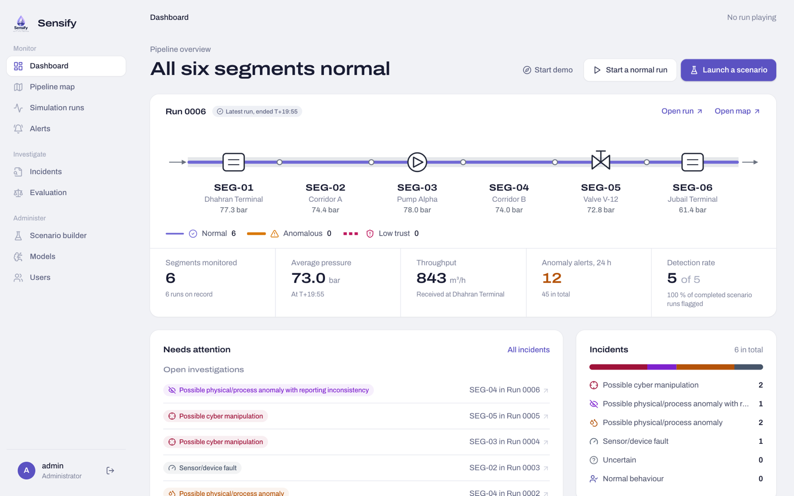
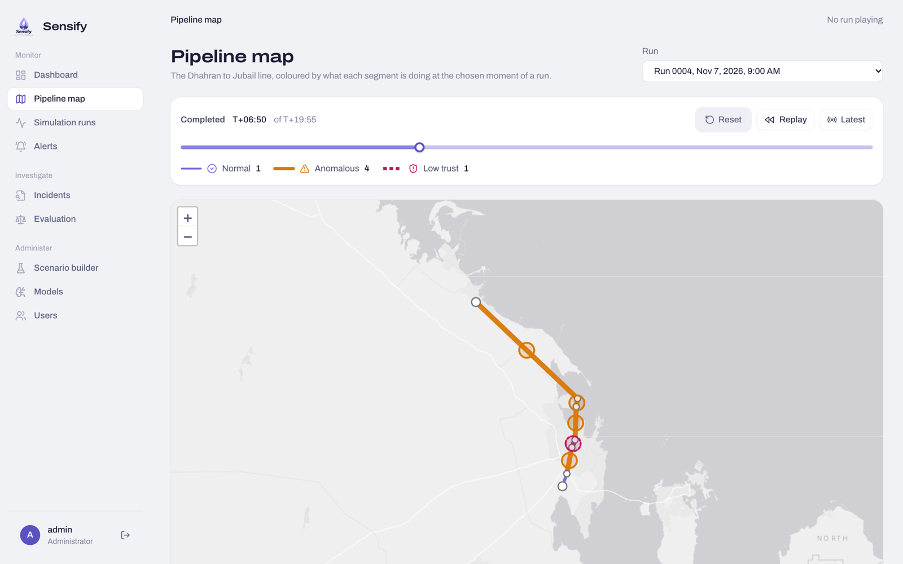
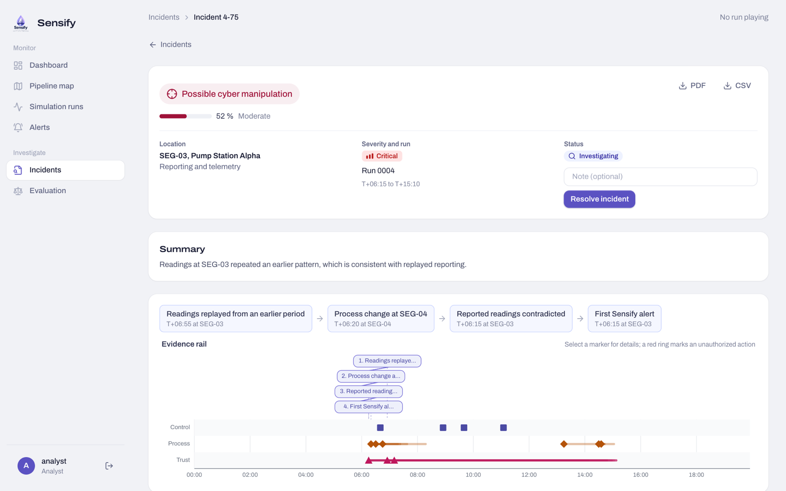
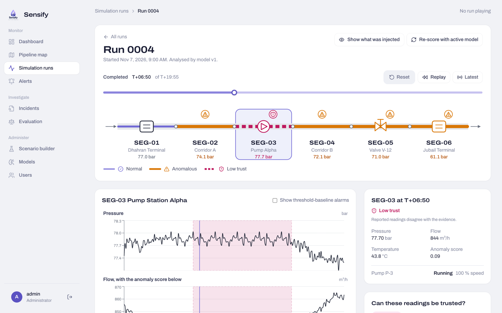
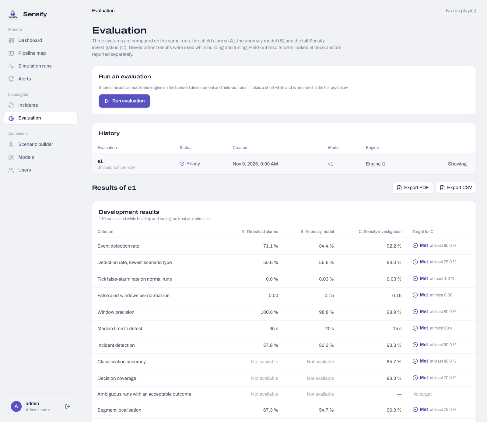

# Sensify

## AI-Assisted Cyber-Physical Incident Investigation Platform




Sensify is an academic software platform for investigating unusual behavior in a simulated petroleum pipeline. It combines machine-learning anomaly detection with process relationships, telemetry reliability, and control/security events to help users understand what happened, where it happened, and which explanation the evidence supports.

A pressure drop can indicate a physical disturbance, a faulty sensor, an expected control operation, or possible cyber manipulation. Sensify brings these observations into one investigation workflow, with evidence and uncertainty visible to the user.

**Project:** SE 499 Senior Project, Semester 261, Prince Sultan University, College of Computer and Information Sciences, Software Engineering Department.  
**Supervisor:** Dr. Mona Alkanhal.  
**Development status:** Source for all three sprints is delivered (release [v3.0](../../releases)). The roadmap below distinguishes delivered source from charter acceptance; story completion is tracked on the Scrum board.

## Current application

Sensify simulates a six-segment pipeline from Dhahran to Jubail and runs reproducible normal, fault and cyber scenarios on it. Each run is scored by a per-segment Isolation Forest model, checked for process consistency and telemetry trust, and compared with threshold alarms. The investigation engine then groups the evidence into incidents and explains them.

- **Sprint 1, platform foundation:** sign-in with Administrator and Analyst roles, user management, dashboard, pipeline map and simulator.
- **Sprint 2, detection and evidence:** scenario builder, anomaly detection, consistency and trust checks, alerts, model training and versioning, synchronized run playback.
- **Sprint 3, investigation and evaluation:** incidents with classification, confidence, evidence, timeline, attack-to-impact chain and MITRE ATT&CK for ICS context; PDF and CSV reports; an evaluation harness comparing threshold-only, ML-only and the full hybrid approach on development and held-out data; and a guided demo mode.

The web application uses Next.js / React; the API uses FastAPI / SQLAlchemy with local SQLite storage.

| Pipeline map during a run | Incident investigation |
| --- | --- |
|  |  |
| **Run playback** | **Evaluation** |
|  |  |

### Development evaluation (e4)

The latest recorded evaluation ([e4](backend/evaluations/e4/report.md), engine i2, model v1) compares the three approaches. Development and held-out results are never pooled, and missed targets are reported as missed.

| Data | Full hybrid: targets met | Selected results |
| --- | --- | --- |
| Development test split (110 runs) | 14 of 14 | Event detection 92.2 %, incident detection 93.3 %, classification accuracy 85.7 %, segment localisation 96.0 % |
| Independent held-out set (72 runs) | 8 of 15 | Event detection 71.7 %, incident detection 80.0 %, classification accuracy 73.2 %, segment localisation 91.1 % |

The held-out scenarios are deliberately weaker, earlier and longer than the development ones. These are the project's development targets; the charter acceptance targets below are evaluated separately.

## Quick start

Full instructions, including Windows, are in [docs/SETUP.md](docs/SETUP.md).

```sh
python3 -m venv .venv && source .venv/bin/activate
python -m pip install -r backend/requirements.txt
cp backend/.env.example backend/.env      # then set JWT_SECRET, ADMIN_PASSWORD, ANALYST_PASSWORD
cd backend && python -m ml.train --generate --activate && uvicorn app.main:app --port 8000
# second terminal
cd frontend && cp .env.example .env.local && npm ci && npm run dev   # http://localhost:3000
```

Generated datasets, trained models, databases, credentials, dependencies and caches are not committed; the setup regenerates them locally.

## Repository layout

| Path | Contents |
| --- | --- |
| `backend/app/` | FastAPI application: simulator (`sim/`), analysis (`analysis/`), investigation engine (`investigation/`), reports, routes and services |
| `backend/ml/` | Dataset generation, model training, held-out set and evaluation harness ([model guide](backend/ml/README.md)) |
| `backend/evaluations/` | Recorded evaluations e1 to e4 |
| `backend/tests/` | Backend test suite (252 tests) |
| `frontend/src/` | Next.js application: pages, components and API client |
| `docs/` | Setup guide, sprint import records, design documents and [project reference](docs/PROJECT_STATUS.md) |

## Charter capabilities

The charter's capabilities below are implemented in the current source. Whether each meets its acceptance criteria is recorded on the Scrum board and in the evaluation.

- Simulate approximately 5–8 connected pipeline segments with synchronized pressure, flow, valve-state, and equipment-state records.
- Introduce configurable physical/process disturbances, sensor/device faults, and three cybersecurity scenarios: telemetry manipulation, unauthorized control manipulation, and a concealed physical incident.
- Train and validate one primary ML approach on designated normal-operation data, then record anomaly scores and detection times.
- Check process consistency across variables, equipment states, and neighboring segments.
- Assess whether reported telemetry is supported, contradicted, or insufficiently verified by available evidence.
- Correlate measurements and control/security events to classify, localize, and reconstruct incidents.
- Explore findings through a clickable pipeline diagram, synchronized trends, alerts, incident timelines, and verification guidance.
- Display justified MITRE ATT&CK for ICS mappings for implemented scenario behaviors.
- Compare threshold monitoring, ML-only detection, and the full hybrid investigation approach; export incident and evaluation reports as PDF and CSV.

## Investigation workflow

1. An Admin configures a reproducible simulation run and, where required, a controlled scenario.
2. The simulator generates observable operational measurements and events using a common simulation clock.
3. Detection and analysis produce anomaly scores, process-consistency findings, and telemetry-trust assessments.
4. The investigation engine groups related evidence and produces supported classifications, locations, timelines, and attack-to-impact traces.
5. An Analyst inspects the pipeline, reviews the evidence and uncertainty, and follows suggested verification steps.
6. Separate ground-truth records support repeatable evaluation of the three approaches.

### Incident categories

- Normal
- Possible Physical/Process Anomaly
- Sensor/Device Fault
- Possible Cyber Manipulation
- Uncertain

Anomaly scores do not establish an incident's cause. Timing alone does not establish causation. Unsupported locations and event chains must remain undetermined, and incomplete or conflicting evidence must be visible.

## Architecture

The system consists of a role-based web application, a protected backend API, simulation and collection components, detection and analysis components, an incident investigation engine, and evaluation/reporting components.

| Component | Responsibility |
| --- | --- |
| Web application | Dashboard, interactive pipeline map, investigation views, administration |
| Backend API | Authentication, role-based access, requests and results |
| Simulation and collection | Pipeline model, virtual OT/SCADA, scenario injection, measurement and event collection |
| Detection and analysis | ML anomaly detection, process consistency, telemetry trust |
| Incident investigation | Classification, localization, evidence correlation, timelines, impact tracing |
| Storage | Application records, operational data, model versions, separate evaluation ground truth |
| Evaluation and reports | Threshold, ML-only, and hybrid comparisons; downloadable results |

**Evaluation independence is essential:** hidden simulator state and scenario ground-truth labels must never be used as operational inputs to produce investigation findings. Training, validation, and final test data must have documented separation. Runs must retain configuration, random seed where applicable, model version, and analysis settings.

## User roles

**Analyst:** inspect runs, telemetry, alerts, incidents, evidence, timelines, evaluation results, and reports.  
**Admin:** all Analyst capabilities, plus management of accounts, simulation runs, scenarios, models, and evaluation execution. Permissions must be enforced in both the interface and the API.

## Scrum roadmap

The backlog follows the charter's 21 user stories. Each issue retains its story ID, priority, and acceptance criteria. Source delivery does not by itself establish that a story meets every acceptance criterion. Use the live board for current story status and acceptance evidence.

| Sprint | Charter window | Status | Stories | Completion milestone |
| --- | --- | --- | --- | --- |
| 1 — Platform Foundation | Weeks 2–5 | Source delivered | US-01–US-07 | Users can log in, open a run, and explore pipeline conditions with permissions enforced. |
| 2 — Detection and Evidence | Weeks 5–9 | Source delivered | US-08–US-14 | An Admin can launch a scenario, and both roles can inspect anomalies and supporting evidence. |
| 3 — Investigation and Evaluation | Weeks 9–13 | Source delivered | US-15–US-21 | Users can follow an incident from detection to explanation and review comparative results. |

Browse the [user-story issues](../../issues) and the repository's [Projects tab](../../projects) for the Scrum board.

## Evaluation targets

These are preliminary charter acceptance targets for controlled simulation experiments, not achieved results. The development evaluation above uses the project's own targets and does not by itself establish these.

| Measure | Target |
| --- | --- |
| Anomaly detection F1 | ≥ 0.75 |
| Incident classification macro F1 | ≥ 0.70 |
| Affected segment identification | ≥ 80% of eligible scenarios |
| Faulty/manipulated telemetry-source identification | ≥ 75% of applicable scenarios |
| False-positive rate | ≤ 10% of evaluated normal observation units |
| Relevant cyber/control event identification | ≥ 80% of supported cyber scenarios |
| Major-event timeline ordering | ≥ 80% of supported scenarios |
| Principal attack-to-impact sequence reconstruction | ≥ 75% of supported scenarios |

Evaluation will also record detection delay and representative-user task outcomes. Before final testing, define scoring units, scenario eligibility, handling of Uncertain outcomes, and event-matching rules. Use the same applicable test data across approaches, report scenario counts and observed errors, and distinguish development results from independently prepared held-out results.

## Scope and constraints

The core is a software prototype using synthetic data and a simplified virtual OT/SCADA environment. Development, evaluation, and documentation fit a planned 14-week period, with five students and a maximum proposed budget of 2,000 SAR. A small water-based demonstrator is a stretch deliverable after the core software and evaluation are complete.

Out of scope: real petroleum-company data or infrastructure, production SCADA/DCS integration, autonomous control or emergency shutdown decisions, production-grade hydraulics, definitive attack attribution, full predictive maintenance, a complete SIEM/IDS/IPS, comprehensive attack-framework coverage, adversarial learning, CCTV, facial recognition, and real petroleum handling.

## Team

The charter proposes the following work-area leads; all members also contribute to integration, testing, documentation, and presentation.

| Team member | Proposed lead area |
| --- | --- |
| Ghala Aljarallah | Pipeline simulator, topology, normal operational data |
| Renad Alsukayt | Dataset preparation, ML training/evaluation, threshold monitoring |
| Layan Algublan | Fault/cyber scenarios, event recording, MITRE ATT&CK for ICS mappings |
| Donia Aldawsari | Consistency/trust checks, evidence correlation, classification, timelines |
| Layla Albelbisi | Authentication, user management, dashboard, backend/interface integration |

## Development and contribution

See the [Sprint 3](docs/SPRINT_3_IMPORT.md) and [Sprint 2](docs/SPRINT_2_IMPORT.md) import and verification records for packaging changes, test results and remaining dependency warnings.

The application uses a Next.js / React frontend and a FastAPI / SQLAlchemy backend with a locally generated SQLite database. See [local setup instructions](docs/SETUP.md) for installation, environment configuration, initial model training, local accounts, and automated checks. Configure your own secrets using the committed `.env.example` templates; local environment files, databases, dependencies, and build caches are excluded from Git.

- Link branches and pull requests to the relevant user-story issue.
- Review the story's acceptance criteria before implementation and record validation evidence before marking it Done.
- Preserve common run, timestamp, and source identifiers across component interfaces.
- Keep credentials outside source code and exclude private participant records and secrets from commits.
- Review scope, schedule, budget, or acceptance-criteria changes with the team and supervisor, then update the backlog and relevant documentation.

The final project submission is planned to include the integrated prototype, requirements/design documentation, experimental results, and an end-to-end investigation demonstration. Unmet targets and incomplete requirements must be documented with their impact and follow-up.
